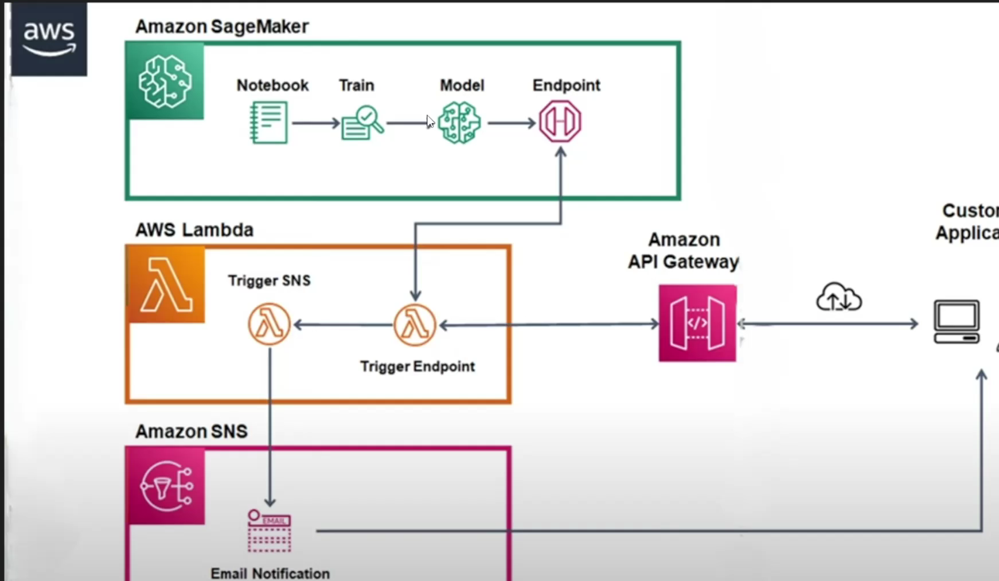
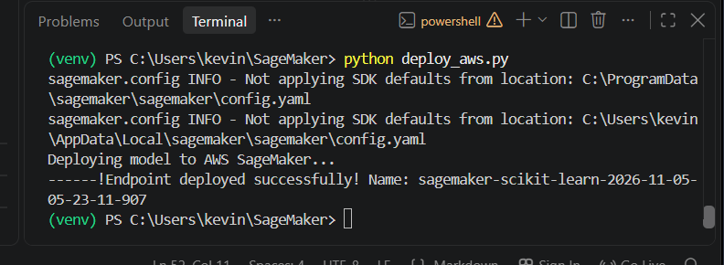

# Machine Learning Model Training and Deployment with AWS SageMaker


## Project Architecture

The following diagram illustrates the AWS-based machine-learning workflow and the services involved.




## Project Overview

This project demonstrates a basic machine-learning workflow using Python and Scikit-learn. It trains a Random Forest classifier on generated sample data, saves the trained model, packages it for inference, and provides scripts to deploy and test the model locally with Docker or on AWS SageMaker.

The training script uses Scikit-learn's `make_classification` function to generate a small sample dataset with 100 records and 4 input features. A `RandomForestClassifier` is trained on this data and saved as `model.joblib`.

> **Note:** The supplied training script uses generated demonstration data. It is not a model trained on a real-world dataset, and its predictions should be treated as a technical demonstration rather than a production prediction system.

## Features

- Generates sample classification data with four input features.
- Trains a Scikit-learn Random Forest classifier.
- Saves the trained model using Joblib.
- Includes a SageMaker inference handler in the model archive.
- Supports local inference using the SageMaker local mode and Docker.
- Includes a script for deploying the model to AWS SageMaker.
- Includes a script for sending prediction requests to a SageMaker endpoint.

## Project Files

The uploaded files serve the following purposes:

| File | Description |
|---|---|
| `train.py` | Generates sample data, trains the Random Forest classifier, and saves `model.joblib`. |
| `model.joblib` | Serialized trained model produced by the training script. |
| `model.tar.gz` | SageMaker model archive. It contains `model.joblib` and the `code/inference.py` inference handler. |
| `model.tar.gz.model.joblib` | Additional model-related file supplied with the project. Its exact role in the workflow is not established by the scripts. |
| `deploy_local.py` | Starts a local SageMaker endpoint using Docker, sends a sample prediction, and deletes the endpoint afterward. |
| `deploy_aws.py` | Deploys the model archive to an AWS SageMaker endpoint. |
| `test_endpoint.py` | Invokes a configured SageMaker runtime endpoint and prints the prediction. |
| `docker-compose.bat` | Windows batch wrapper that forwards its arguments to `docker compose`. |

The local and AWS deployment scripts refer to an inference source directory named `code`. The supplied `model.tar.gz` archive contains `code/inference.py`.

## Technologies Used

- **Python** — application and training scripts.
- **Scikit-learn** — sample data generation and Random Forest classification.
- **Joblib** — saving and loading the trained model.
- **NumPy** — handling prediction output in the inference handler.
- **Docker** — running the model container in local SageMaker mode.
- **AWS SageMaker** — hosting the model as an endpoint.
- **Boto3 / Botocore** — AWS SDK and API interaction.

## Requirements

Install or configure the following before running the relevant parts of the project:

- Python 3
- pip
- Docker Desktop (for local Docker deployment)
- An AWS account and configured AWS credentials (for AWS deployment)
- An AWS SageMaker execution role with the permissions required for model deployment and inference

The deployment script specifies the SageMaker Scikit-learn framework version `1.2-1`. The model archive should be used with a compatible Scikit-learn environment. The training artifact may have been created with Scikit-learn 1.2.2; Scikit-learn model files are not guaranteed to be compatible across versions.

Install the Python packages used by the scripts:

```bash
pip install sagemaker scikit-learn joblib numpy boto3 botocore
```

For reproducible results, use package versions compatible with the Scikit-learn version used to create `model.joblib` and the SageMaker container. The supplied files do not include a pinned `requirements.txt`.

## How to Run

### 1. Train the model

Run:

```bash
python train.py
```

The script:
1. Generates 100 sample records with 4 features.
2. Creates a `RandomForestClassifier`.
3. Trains the classifier.
4. Saves the trained model as `model.joblib` in the current directory.

If you retrain the model, make sure the model archive used for deployment is updated with the new model file.

### 2. Run the model locally with Docker

Make sure Docker Desktop is installed and running. From the project directory, run:

```bash
python deploy_local.py
```

The local deployment script:
1. Creates a SageMaker `LocalSession`.
2. Configures the local Scikit-learn inference image.
3. Loads `model.tar.gz` and the `code/inference.py` handler.
4. Starts a local endpoint using the `local` instance type.
5. Sends a sample input containing four features.
6. Prints the prediction.
7. Deletes the local endpoint container.

The sample input in the script is:

```python
[[0.5, -0.2, 1.1, -0.5]]
```

**Important:** `deploy_local.py` currently sets example AWS credentials in environment variables and mocks selected AWS API calls. These values are placeholders, not credentials to use for real AWS access. Review this setup before running the script, and do not put real access keys in source code.

### 3. Deploy the model to AWS SageMaker

Before deployment, check `deploy_aws.py` and update its configuration for your AWS account:

- `model_data`: the S3 URI where `model.tar.gz` is stored.
- `role`: the ARN of your SageMaker execution role.
- `framework_version`: the framework version compatible with the model.
- `instance_type`: the SageMaker instance type you intend to use.

Upload the model archive to the configured S3 location, then run:

```bash
python deploy_aws.py
```

The script creates a SageMaker session and deploys one model instance using `ml.m5.xlarge`. It prints the endpoint name returned by SageMaker.

**AWS costs:** Creating a SageMaker endpoint can incur charges while the endpoint is running. Delete the endpoint when it is no longer needed.

### 4. Test the AWS endpoint

Open `test_endpoint.py` and set `endpoint_name` to the actual endpoint name created by your deployment. Confirm that the AWS region is correct and that your AWS credentials have permission to invoke the endpoint.

Run:

```bash
python test_endpoint.py
```

The script sends this four-feature JSON payload:

```json
[[1.0, 2.0, 3.0, 4.0]]
```

It then prints the prediction returned by SageMaker. If the endpoint reports `ModelNotReadyException`, the script retries up to 10 times, waiting 5 seconds between attempts.

## Inference Handler

The `code/inference.py` file is included inside `model.tar.gz`. It defines two functions used by the SageMaker Scikit-learn serving process:

- `model_fn(model_dir)` — loads `model.joblib` from the model directory.
- `predict_fn(input_data, model)` — calls the model's `predict` method and returns the prediction as a NumPy array.

The inference handler expects input compatible with the model's four features.

## Configuration and Troubleshooting

- **S3 model location:** The S3 URI in `deploy_aws.py` must point to an uploaded `model.tar.gz` file.
- **Execution role:** The SageMaker role must exist and have the permissions needed by the deployment.
- **Region:** Keep the AWS region consistent across the endpoint deployment and test client.
- **Endpoint name:** Update `test_endpoint.py` with the endpoint name printed by `deploy_aws.py`. The test script's current endpoint name is hard-coded and may not match a newly deployed endpoint.
- **Model compatibility:** Use a compatible Scikit-learn version when loading the serialized model. A version mismatch can cause warnings or loading errors.
- **Docker:** Ensure Docker Desktop is running before using local mode.
- **Inference code:** Keep the `code/inference.py` file available in the expected `code` directory when running the deployment scripts.

## Docker Compose Helper

`docker-compose.bat` is a small Windows command wrapper:

```bat
@echo off
docker compose %*
```

For example, it forwards a command such as:

```bat
docker-compose up
```

to Docker Compose. The supplied files do not include a `compose.yaml` or `docker-compose.yml` configuration, so this helper alone does not define or start any project services.

## Security Notes

- Do not commit real AWS access keys, secret keys, account-specific credentials, or sensitive configuration to a public repository.
- Use an AWS credentials profile, environment configured outside source control, or an appropriate IAM role for real AWS access.
- The credentials currently present in `deploy_local.py` are example placeholder values. Replace or remove the mock setup as appropriate before using real AWS services.
- Review IAM permissions and endpoint costs before deploying to AWS.

## Future Improvements

- Replace generated sample data with a real, documented dataset.
- Add a `requirements.txt` with tested, pinned dependency versions.
- Add automated tests for training and inference.
- Add a configuration file or environment variables for endpoint names, regions, S3 paths, and IAM roles.
- Add a documented endpoint cleanup step for AWS deployments.

## License

No license information was included with the supplied project files. Add a license before distributing or publishing the project if needed.

## Deployment Output

The screenshot below shows the successful deployment message returned by the AWS SageMaker deployment script, including the created endpoint name.


